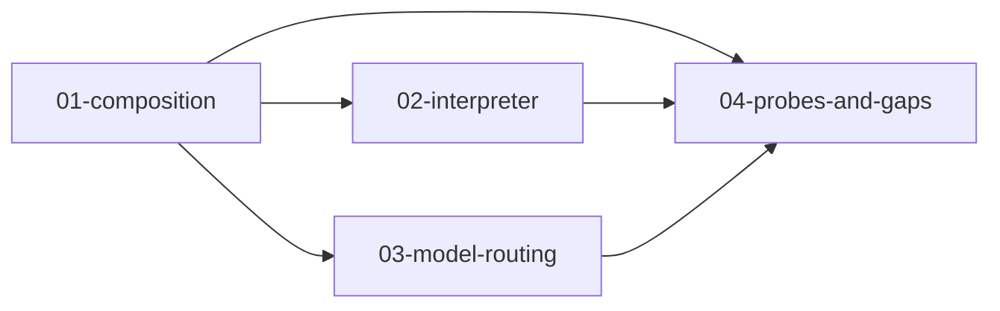

# Design pack — agent composition, review, enforcement, assurance

These documents specify **what to build next** for the governance half of the product (tracing is already live). They are written for a single implementer working vertical slices; they do not repeat `AGENTS.md`, but every decision respects it.

## Read order and dependencies

| Doc | Title | Depends on | Unblocks |
|-----|--------|------------|----------|
| [01-agent-composition.md](./01-agent-composition.md) | What an agent is made of | AAP 0.1 baseline, `bom`, `operations` | Descriptor truth, drift signals |
| [02-intelligent-interpreter.md](./02-intelligent-interpreter.md) | Semantic review for non-technical humans | `releases/differ`, `materiality/rules`, Design 1 | Release UX, CI gate copy |
| [03-model-routing-residency.md](./03-model-routing-residency.md) | Detection vs prevention for model residency | Design 1, `engagements`, `policy`, `policy_decisions` | Production compliance |
| [04-stress-testing-rule-suggestion.md](./04-stress-testing-rule-suggestion.md) | Probes and regulatory gap analysis | Design 1–2, `probe_suites`, `frameworks` | Pre-release assurance |

**Shared vocabulary (use consistently across all four):**

- **Declared** — present in the published AAP descriptor (or derived BOM row) for an `agent_version_id`.
- **Observed** — seen in `run_steps` / `tool_usage_daily` within a window.
- **Reconciled** — declared ∩ observed with normalisation (D-039 keys); mismatch raises a **finding**, not a silent fix.
- **Obligation** — a bounded, structured statement of what a rule *requires* (never full prompt text in Postgres evidence).

---

## Recommended implementation order

Build in this sequence. Each bullet is the **first vertical slice** — schema flag + migration note, service, API, one console surface — tight enough to start coding without re-deciding.

### Phase A — Composition truth (Design 1) — **mechanical with one hard corner**

1. **AAP 0.2 schema bump (breaking)** — add `composition` block: `model_policy`, `rule_sources`, `skills`, `sub_agents`, `configs` (see Design 1). Golden files in `packages/aap-cli` and `examples/` must version together. *Hard part:* PO must accept 0.2 vs cramming into `additionalProperties` (Open question in Design 1).
2. **`aap extract` (CLI)** — static harvest from repo paths listed in descriptor; output patches descriptor fields + digests only. No new API service yet.
3. **`bom.extract_components` + differ** — extend extraction and `_diff_*` for new categories; new `ChangeCategory` values if needed (`SKILL`, `CONFIG`, `MODEL_POLICY`, `RULE_OBLIGATION`).
4. **`composition_reconciliations` table + worker job** — nightly (or on run close): compare declared vs observed per agent; emit `findings` with fingerprints (`declared-vs-observed:*`). Console: agent **Composition** tab — declared | observed | status columns (reuse Tools & MCP patterns).

*Genuinely hard:* structured **rule obligations** without storing prompts (Design 1 § Rules). *Mechanical:* MCP/tool/model reconciliation already exists; extend keys once Q-017 (`name` on MCP server) is decided.

### Phase B — Interpreter (Design 2) — **mostly mechanical**

1. **`ReleaseReviewBrief` API** — `GET /v1/releases/{id}/review-brief`: deterministic sentences from `SemanticChange` + `describe_rule()`; **no LLM on critical path**.
2. **Materiality context wiring** — `preview_release` / `create_release` pass engagement + accreditation context into `MaterialityContext` (approved regions/classes from engagement agent pin).
3. **Console release detail** — split pane: **Summary** (brief) | **Semantic changes** (existing) | **Source diff** (link/embed via `vcs_*` fields; no diff storage in Postgres initially).
4. **Adjudication record** — already on `release_changes`; add evidence event on approve/reject of release (`EvidenceKind` TBD in Design 2).

*Hard:* mapping capabilities → plain language (“can issue refunds”) requires a **capability taxonomy** or human-authored capability descriptions in descriptor — not inferring from tool names alone.

### Phase C — Model routing (Design 3) — **hardest program in the pack**

1. **Reference catalogue** — migration `0010_model_catalogue`: `model_catalog_entries` (nullable `org_id`). Seed ~50 common models; admin CRUD. Unknown model → catalogue row missing.
2. **Policy bind API** — extend `EvaluationRequest` with `model_id`, `hosting_region`, `selection_mode`; evaluate against engagement + descriptor + catalogue. Persist to `policy_decisions`. Still **detection-only** if called post-hoc from run ingest.
3. **`services/llm-gateway/` sidecar (Go or Python — follow D-001)** — HTTP forward proxy; calls policy evaluate; fail-closed when `lifecycle_state=production` and unknown model. *Not* in FastAPI request path for console.
4. **SDK integration doc + Cursor SDK hook** — route `base_url` through gateway in production; bypass detection via direct provider calls documented as finding `gateway-bypass`.

*Unworkable without customer action:* enforcement if agents call Anthropic/OpenAI directly. The product can **detect** bypass (observed model not in allowed set + no matching `policy_decision` within Δt) but cannot prevent it without network or SDK changes.

### Phase D — Probes and gaps (Design 4) — **medium; trust model is the hard part**

1. **Probe runner worker** — consume `probe_suites`, execute against agent **staging** endpoint; store `probe_runs.results_json` with deterministic checks first.
2. **Release gate hook** — optional `requires_probe_suite: slug` on accreditation; block if last `probe_run.result != pass` within TTL.
3. **Gap analysis report** — `GET /v1/agents/{id}/rule-gaps?framework=`: map `control_mappings` → required obligation templates vs descriptor `rule_obligations`; no LLM required for v1.

---

## Blunt difficulty assessment

| Area | Difficulty | Why |
|------|------------|-----|
| Extend differ + materiality for new descriptor fields | Mechanical | Pattern exists in `differ.py` / `rules.py` |
| Static repo extraction for LangGraph/Cursor | Medium | Convention-based; breaks on exotic layouts |
| Declared vs observed reconciliation | Mechanical | `operations` + `bom` already do half |
| Rule obligations without prompt storage | **Hard** | Legal + UX; needs PO on extraction ownership |
| Deterministic review brief | Mechanical | Templates over structured changes |
| LLM-generated summaries | Easy to build, **dangerous** | Must not gate releases |
| Model catalogue maintenance | Medium ongoing | Operational burden, not code |
| In-path gateway + latency budget | **Hard** | New deployable, streaming, provider quirks |
| Provider sub-region routing | **Hard / partly infeasible** | Detection only; honest in Design 3 |
| Probe judgement without hallucination | Medium | Deterministic expects + tool-traces |
| Regulatory gap suggestions | Medium | Paraphrased controls (Q-001); mapping work |

---

## Documents in this folder

- [01-agent-composition.md](./01-agent-composition.md)
- [02-intelligent-interpreter.md](./02-intelligent-interpreter.md)
- [03-model-routing-residency.md](./03-model-routing-residency.md)
- [04-stress-testing-rule-suggestion.md](./04-stress-testing-rule-suggestion.md)

When implementation starts, flag required migrations in `PROJECT_STATE.md` as `written` until applied on real Postgres.
